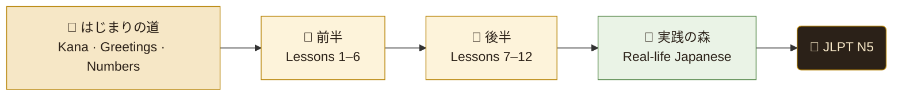
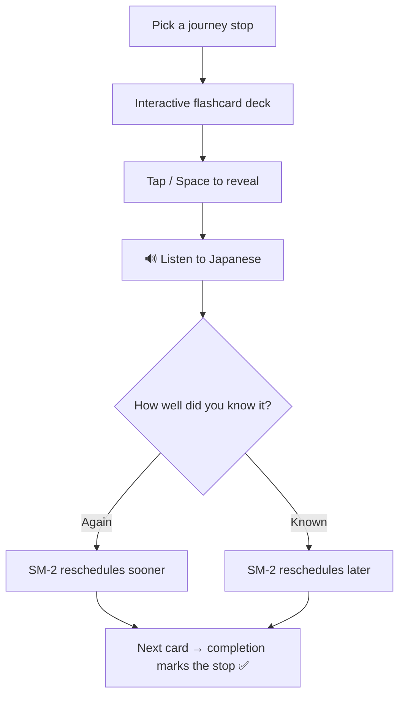

# 🌸 AKIRA NIHONGO

### あきら にほんご — *a calm journey from zero to JLPT N5*

> **AKIRA NIHONGO** is a premium, offline-first Japanese self-study app built around the
> **GENKI I** first-year curriculum. It turns a complete syllabus into a single guided path:
> one interactive flashcard at a time, with spaced repetition and real-life conversation modules.

---


---

## 🧭 The journey, at a glance



**One chapter at a time. One card at a time.** The home screen is a winding map with a single
clear *current mission*; everything else stays folded until you are ready for it.

---

## ✨ Why it feels different

| Principle | What you get |
|---|---|
| 🃏 **Flashcard-first** | Every teaching page is a fully interactive card deck — reveal, listen, rate recall, shuffle, navigate. No static tables or walls of text. |
| 🧭 **Journey-first** | A windowed path of 16 stops across four chapters, with explicit completion and a living "current mission". |
| 🧠 **Spaced repetition** | SM-2 scheduling remembers the hard cards and spaces out the easy ones. |
| 🗣️ **Real Japanese** | 15 scenario modules take you from self-introductions to shopping, travel, health and etiquette. |
| 🌐 **Two UI languages** | Switch Japanese ⇄ English from the menu bar; your choice is saved for every launch. Study content always stays in Japanese. |
| 🔒 **Private by default** | Everything runs locally. Progress lives in a SQLite file on your machine — no account, no telemetry. |
| 🎨 **Premium identity** | Pure-vector brush crest, warm gold/ink palette, bundled Inter + Noto Sans JP fonts, and a logo-only cinematic intro. |
| 📱 **Adaptive layout** | Navigation collapses on narrow windows; the study canvas scrolls and centers cards at any size. |

---

## 📦 What's inside

| Collection | Count | Notes |
|---|---:|---|
| Vocabulary | **568** | Lesson-tagged, with reading and meaning |
| Grammar points | **81** | Explanations plus examples |
| Phrases & expressions | **421** | Greetings, numbers, useful language |
| Kana characters | **236** | Hiragana, katakana, voiced, contracted, extended |
| Lessons | **12** | GENKI I, each with vocab → grammar → culture → expressions |
| Real-life modules | **15** | Practical conversation scenarios |
| Journey levels | **16** | Four chapters from はじまりの道 to 実践の森 |

---

## 🚀 Quick start

### Requirements

- Python **3.10+** (3.12 recommended)
- Windows, Linux, or macOS

### Run from source

```powershell
git clone https://github.com/your-username/akira-nihongo.git
cd akira-nihongo
pip install -r requirements.txt
python main.py
```

On Windows you can also double-click **`run.bat`**.

Set `AKIRA_SKIP_INTRO=1` to bypass the startup animation (handy for automation):

```powershell
$env:AKIRA_SKIP_INTRO=1; python main.py
```

---

## 🃏 The study loop



<details>
<summary><b>Practice modes</b> — click to expand</summary>

- **Kana drill** — recognition and typing practice for hiragana / katakana.
- **Flashcards** — spaced-repetition review across any lesson or deck.
- **Quiz** — vocabulary, grammar, kana and reading questions with instant explanations.
- **Search** — one box over the entire curriculum (`Ctrl+K`).

</details>

---

## ⌨️ Shortcuts

| Shortcut | Action |
|---|---|
| `Ctrl + K` | Focus global search |
| `Ctrl + T` | Toggle light / dark theme |
| `Space` / `Enter` | Reveal a card, then rate it as known |
| `←` / `→` | Previous / next card |
| `S` | Shuffle the current deck |
| Menu bar 🌐 | Toggle Japanese ⇄ English interface language |
| Click / any key during intro | Skip the startup animation |

---

## 🏗️ Project structure

```text
AKIRA NIHONGO/
├── main.py                         # application entry point + intro wiring
├── requirements.txt                # PySide6>=6.6
├── run.bat                         # Windows double-click launcher
├── build_windows.bat               # one-command PyInstaller build
├── akira_nihongo.spec              # PyInstaller recipe (single-file exe)
├── pysidedeploy.spec               # shared Qt deploy config (desktop + Android)
├── ANDROID.md                      # full Android APK build guide
├── docs/
│   └── ARCHITECTURE.md             # design notes and data model
├── nihongo_app/
│   ├── core/
│   │   ├── database.py             # SQLite progress, settings, journey stops
│   │   ├── models.py               # typed content records
│   │   ├── quiz.py                 # question/deck generation
│   │   └── srs.py                  # SM-2 scheduler
│   ├── data/
│   │   ├── kana.py                 # 236 kana characters
│   │   ├── intro.py                # greetings, bowing, numbers basics
│   │   ├── lessons_a.py            # lessons 1–6
│   │   ├── lessons_b.py            # lessons 7–12
│   │   ├── real_life.py            # 15 scenario modules
│   │   └── registry.py             # unified curriculum registry
│   ├── resources/
│   │   ├── akira_logo.svg          # pure-vector emblem (no lettering)
│   │   └── fonts/                  # Inter + Noto Sans JP (SIL OFL)
│   └── ui/
│       ├── theme.py                # palette, QSS, font loading
│       ├── logo.py                 # Qt-painted logo renderer
│       ├── intro.py                # logo-only cinematic startup
│       ├── i18n.py                 # persisted Japanese/English UI translation
│       ├── study_deck.py           # shared scrollable, centered flashcard deck
│       ├── widgets.py              # cards, panels, pills, progress ring
│       ├── main_window.py          # journey shell, nav rail, menus, shortcuts
│       ├── speech.py               # graceful optional Japanese TTS
│       └── pages/                  # every journey/practice page
```

---

## 📦 Packaging

### 🪟 Windows — executable

**Prebuilt:** [`packages/windows/AkiraNihongo.exe`](packages/windows/AkiraNihongo.exe) — single-file
v1.2.0 build. Verify it with the adjacent `AkiraNihongo.exe.sha256` checksum.

A ready-to-run build script is included:

```powershell
pip install pyinstaller
.\build_windows.bat
```

The single-file app is written to `dist/AkiraNihongo.exe`. Fonts and the vector logo are bundled
inside it; no separate install is needed. Launch it and the same journey appears — progress is
read from the same local SQLite file.

```powershell
.\dist\AkiraNihongo.exe
```

### 🤖 Android — APK build configuration

> **Status: source-ready, not pre-built.** PySide6 APKs must be compiled on a **Linux host**
> with `pyside6-android-deploy` + Buildozer (NDK r28c, JDK 17+). This repository ships the
> complete `pysidedeploy.spec` and a step-by-step guide — see **[ANDROID.md](ANDROID.md)**.

```bash
# On Linux / WSL Ubuntu, after the one-time toolchain setup:
pyside6-android-deploy --config-file pysidedeploy.spec
# Debug APK → bin/akiranihongo-debug.apk
```

The app already degrades gracefully when platform modules such as text-to-speech are unavailable,
so the core curriculum, decks and quizzes remain fully functional on device.

---

## 🔒 Your data

Progress is stored locally at:

```text
%USERPROFILE%\.nihongo_sensei\progress.sqlite3
```

That includes lesson completion, journey stops, SRS reviews, streaks, theme, and language choice. **Settings → Export** writes a JSON backup; **Reset** clears it. Nothing is
uploaded.

---

## 🧰 Tech stack

- **Python 3.10+** — application logic and curriculum data
- **PySide6 / Qt 6** — native widgets, painting, animation, typography
- **SQLite** — persistence via the standard library
- **SM-2** — spaced-repetition scheduling
- **PyInstaller** — Windows executable
- **pyside6-android-deploy / Buildozer** — Android packaging

---

## 🤝 Contributing

Contributions are welcome — especially new real-life scenarios, corrected readings, and UX polish.

```bash
git checkout -b feat/my-improvement
python -m compileall -q .
python main.py
git commit -m "feat: my improvement"
```

Please keep teaching content in Japanese, keep UI strings in `ui/i18n.py`, and preserve the
flashcard-first rule: no static content lists in teaching pages.

---

## 📄 License

Application code is released under the **MIT License** — see [LICENSE](LICENSE).

Bundled fonts are distributed under the **SIL Open Font License 1.1**:
see [THIRD_PARTY_NOTICES.md](THIRD_PARTY_NOTICES.md).

---

## 🙏 Acknowledgements

- **GENKI I** — the first-year curriculum that anchors the lesson sequence and content scope.
- **Inter** and **Noto Sans JP** — the bundled typefaces that keep Latin and Japanese text crisp.
- **Qt for Python** — the cross-platform foundation.

> Made for quiet, consistent study. 一歩ずつ、N5 へ。

---

**AKIRA NIHONGO** · あきら にほんご · *From zero to N5, one card at a time.*
