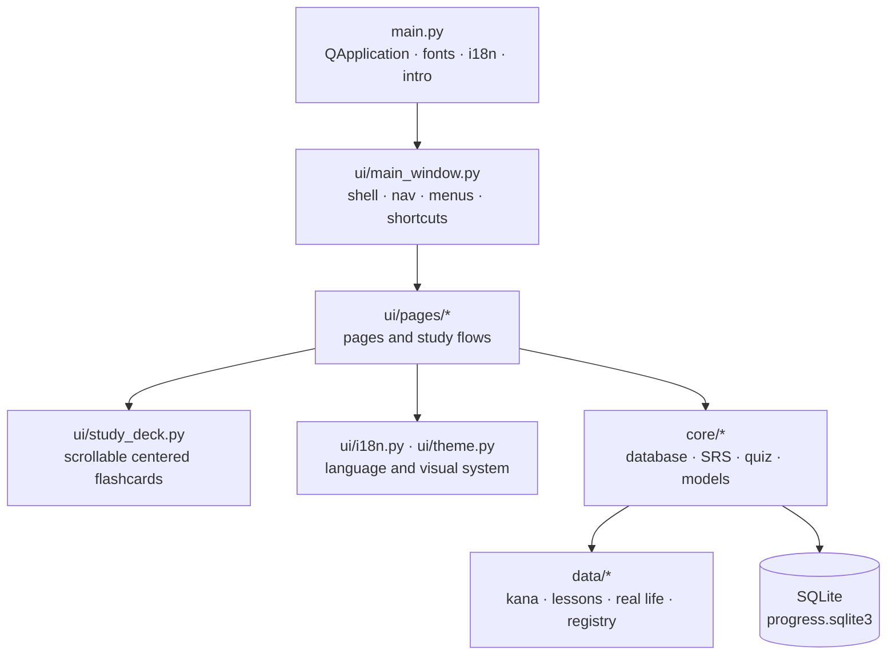

# 🏗️ Architecture

> A short map of how AKIRA NIHONGO is put together, so new work lands in the right place.

---

## Layers



---

## Design decisions

| Decision | Why |
|---|---|
| **One shared `StudyDeck`** | Every teaching page uses the same reveal → audio → rate → next loop. No page ships a static list or table. |
| **Scrollable, centered canvas** | `scroll_center()` wraps decks so cards sit in the middle of large screens and scroll on small ones. |
| **Explicit journey stops** | Completion is stored per stop in `journey_stops`; review activity alone never marks the beginning path complete. |
| **Content stays Japanese** | The language toggle translates only UI chrome; study material is always the real Japanese text. |
| **Local-first persistence** | SQLite plus JSON export keeps the app private, portable and easy to back up. |
| **Vector-only identity** | The crest is painted with Qt primitives; no raster mascot or lettering in the logo/intro. |

---

## Data model

The `Database` class owns all persistence:

| Table / setting | Purpose |
|---|---|
| `lessons` | Explicit lesson completion keys |
| `activity` | Daily reviewed / correct / minutes counters |
| `reviews` | SM-2 card state (`ease`, `interval`, due date) |
| `planner` | Study tasks with day, subject, minutes, note, done flag |
| `settings` | Theme, interface language, journey stops, daily goal |
| `journey_stops` (setting) | Non-lesson stops completed: `foundations`, `greetings`, `numbers`, `real-life`, `planner` |

Progress helpers:

```python
db.journey_stops()          # -> list[str]
db.set_journey_stop(key)    # explicit completion
db.completed_lessons()      # -> list[str]
db.totals()                 # reviewed, correct, streak, accuracy
```

`JourneyProgress` in `ui/pages/dashboard.py` derives chapter state, the current mission and the
overall ratio from these sources. Lesson stops come from `lessons`; all other stops come from
`journey_stops`.

---

## Adding content

1. Put new items in the appropriate module under `nihongo_app/data/`.
2. Export them through `data/registry.py` so search, quizzes and decks can find them.
3. Give each card a stable `uid` — SRS reviews are keyed by it.
4. Keep front/back text plain; `StudyCard` escapes HTML itself.
5. Add any new UI string to `ui/i18n.py` so both languages stay complete.

---

## Adding a journey stop

1. Add the `Stop` entry to `CHAPTERS` in `ui/pages/dashboard.py`.
2. Ensure a page exists for its `nav_key` in `main_window.py` → `_get_page()`.
3. Connect the page's completion event to `self.complete_stop("<key>")` (see `base.py`).

---

## Build targets

| Target | Tool | Output |
|---|---|---|
| Source | `python main.py` | window |
| Windows | `build_windows.bat` → PyInstaller | `dist/AkiraNihongo.exe` |
| Android | `pyside6-android-deploy` (Linux) | `bin/AkiraNihongo-debug.apk` |

See [ANDROID.md](../ANDROID.md) for the full mobile toolchain.
